# Class diagram các bảng đang dùng

**Chức năng:** Sơ đồ lớp Mermaid của 19 bảng mà mã API viết tay đang truy vấn, dán được vào draw.io.

Nguồn: `apps/api/prisma/schema/{identity,catalog,orders}.prisma`. Chỉ lấy model xuất hiện trong `apps/api/src/modules`, `common`, `infra` và `prisma/seed` (lệnh đo: `grep -rhoE '(prisma|tx|db)\.[a-z][A-Za-z]+\b' apps/api/src/modules apps/api/src/common apps/api/src/infra apps/api/prisma/seed`). Các bảng `inventory`, `orders`, `shipments`, `vouchers`, `reviews`, `returns`, `refunds`, báo cáo và staging có trong schema nhưng chưa module nào chạm, nên không vẽ.

Dán vào draw.io: **Arrange → Insert → Advanced → Mermaid**, chọn Diagram, dán khối dưới.

```mermaid
classDiagram
direction TB

%% ===== Enum =====
class UserStatus {
  <<enumeration>>
  PENDING_VERIFICATION
  ACTIVE
  LOCKED
  DISABLED
}
class OtpPurpose {
  <<enumeration>>
  EMAIL_VERIFICATION
  PASSWORD_RESET
  GUEST_RETURN_VERIFICATION
}
class AdministrativeAreaLevel {
  <<enumeration>>
  PROVINCE
  COMMUNE
}

%% ===== Identity (auth, users) =====
class User {
  +UUID id
  +String email
  +String passwordHash
  +UserStatus status
  +String avatarUrl
  +String fullName
  +String phone
  +DateTime emailVerifiedAt
  +Int authVersion
  +DateTime createdAt
  +DateTime updatedAt
}
class Role {
  +UUID id
  +String code
  +String name
  +DateTime createdAt
  +DateTime updatedAt
}
class UserRole {
  +UUID userId
  +UUID roleId
  +DateTime createdAt
}
class OtpCode {
  +UUID id
  +String email
  +UUID userId
  +OtpPurpose purpose
  +String codeHash
  +DateTime expiresAt
  +DateTime consumedAt
  +Int attemptCount
  +Int sendCount
  +DateTime createdAt
}
class RefreshToken {
  +UUID id
  +UUID userId
  +String tokenHash
  +UUID familyId
  +DateTime expiresAt
  +DateTime revokedAt
  +UUID replacedByTokenId
  +DateTime createdAt
}
class AuditLog {
  +UUID id
  +UUID actorUserId
  +String action
  +String entityType
  +UUID entityId
  +Json metadata
  +DateTime createdAt
}
class AdministrativeArea {
  +UUID id
  +String code
  +String name
  +AdministrativeAreaLevel level
  +UUID parentId
  +Boolean isActive
}
class Address {
  +UUID id
  +UUID userId
  +String recipientName
  +String phone
  +UUID administrativeAreaId
  +String detailAddress
  +String postalCode
  +Boolean isDefault
  +DateTime createdAt
  +DateTime updatedAt
}

%% ===== Catalog (products) =====
class Category {
  +UUID id
  +UUID parentId
  +String name
  +String slug
  +Int sortOrder
  +Boolean isActive
}
class Brand {
  +UUID id
  +String name
  +String slug
}
class Color {
  +UUID id
  +String code
  +String name
  +String hex
}
class Size {
  +UUID id
  +String code
  +Int sortOrder
}
class Product {
  +UUID id
  +UUID categoryId
  +UUID brandId
  +String name
  +String slug
  +String description
  +String material
  +String careInstructions
  +Json attributes
  +Decimal priceFrom
  +Boolean isActive
  +Boolean isFeatured
  +String audience
  +DateTime createdAt
  +DateTime updatedAt
}
class ProductVariant {
  +UUID id
  +UUID productId
  +UUID colorId
  +UUID sizeId
  +String sku
  +Decimal listPrice
  +Decimal salePrice
  +Boolean isActive
}
class ProductImage {
  +UUID id
  +UUID productId
  +UUID colorId
  +String url
  +String alt
  +Int sortOrder
}
class SearchQueryLog {
  +UUID id
  +UUID userId
  +String queryText
  +Int resultCount
  +DateTime createdAt
}
class SearchConfiguration {
  +UUID id
  +String configurationKey
  +Json configurationValue
  +DateTime updatedAt
}

%% ===== Cart =====
class Cart {
  +UUID id
  +UUID userId
  +String guestToken
  +DateTime createdAt
  +DateTime updatedAt
}
class CartItem {
  +UUID id
  +UUID cartId
  +UUID productVariantId
  +Int quantity
  +Boolean isSelected
  +DateTime createdAt
  +DateTime updatedAt
}

%% ===== Quan he: *-- xoa theo cha (Cascade), o-- giu cha (Restrict), --> tham chieu loang (SetNull) =====
User "1" *-- "0..*" UserRole : userRoles
Role "1" *-- "0..*" UserRole : userRoles
User "0..1" --> "0..*" OtpCode : otpCodes
User "1" o-- "0..*" RefreshToken : refreshTokens
RefreshToken "0..1" --> "0..*" RefreshToken : replacedByToken
User "0..1" --> "0..*" AuditLog : actorUser
User "1" o-- "0..*" Address : addresses
AdministrativeArea "1" o-- "0..*" Address : administrativeArea
AdministrativeArea "0..1" o-- "0..*" AdministrativeArea : parent / children
User "0..1" --> "0..*" SearchQueryLog : searchQueryLogs
User "0..1" *-- "0..1" Cart : cart
Cart "1" *-- "0..*" CartItem : items
ProductVariant "1" o-- "0..*" CartItem : productVariant

Category "0..1" o-- "0..*" Category : parent / children
Category "1" o-- "0..*" Product : products
Brand "0..1" --> "0..*" Product : brand
Product "1" o-- "1..*" ProductVariant : variants
Product "1" o-- "0..*" ProductImage : images
Color "1" o-- "0..*" ProductVariant : color
Size "1" o-- "0..*" ProductVariant : size
Color "0..1" --> "0..*" ProductImage : color

User ..> UserStatus : status
OtpCode ..> OtpPurpose : purpose
AdministrativeArea ..> AdministrativeAreaLevel : level
```

Quy ước đọc: đầu mũi tên đặc (`*--`) là xoá theo cha (`onDelete: Cascade`), đầu rỗng (`o--`) là giữ cha (`Restrict`), mũi tên thường (`-->`) là tham chiếu lỏng (`SetNull`); nét đứt là dùng enum. Để sơ đồ gọn, các bảng tra cứu (`Role`, `Brand`, `Color`, `Size`, `Category`, `AdministrativeArea`, `ProductVariant`, `ProductImage`) lược bớt `createdAt`/`updatedAt`; schema vẫn có đủ. Cột nullable không đánh dấu riêng, xem schema.
