# Sơ đồ use case tổng quan

**Chức năng:** Sơ đồ tổng quan 55 use case toàn hệ thống (bộ số PR #26 cộng UC-11.3) theo 6 tác nhân và quan hệ include, extend.

> Sơ đồ Mermaid dưới đây hiển thị trực tiếp trên GitHub.
> File draw.io đầy đủ với quan hệ `<<include>>`/`<<extend>>` ở cùng thư mục: `uc-tong-quan.drawio.png`.

---

## Sơ đồ tổng quan theo tác nhân

```mermaid
graph LR
    %% ===== ACTORS =====
    KVL(["Khách vãng lai"])
    KH(["Khách hàng"])
    NV(["Nhân viên"])
    QTV(["Quản trị viên"])
    SHP(["Shipper"])
    CTT(["Cổng thanh toán"])

    %% ===== UC-01: Tài khoản & Xác thực =====
    subgraph UC01["UC-01 · Tài khoản & Xác thực"]
        UC0101("UC-01.1 Đăng ký tài khoản")
        UC0102("UC-01.2 Xác thực email OTP")
        UC0103("UC-01.3 Đăng nhập hệ thống")
        UC0104("UC-01.4 Làm mới phiên & đăng xuất")
        UC0105("UC-01.5 Quên & đặt lại mật khẩu")
        UC0106("UC-01.6 Đổi mật khẩu")
        UC0107("UC-01.7 Cập nhật thông tin cá nhân")
        UC0108("UC-01.8 Quản lý địa chỉ giao hàng")
        UC0109("UC-01.9 Cập nhật hồ sơ vóc dáng")
    end

    %% ===== UC-02: Quản trị tài khoản =====
    subgraph UC02["UC-02 · Quản trị tài khoản"]
        UC0201("UC-02.1 Quản trị tài khoản & khóa")
        UC0202("UC-02.2 Quản lý nhân viên & phân quyền")
    end

    %% ===== UC-03: Khám phá sản phẩm =====
    subgraph UC03["UC-03 · Khám phá sản phẩm"]
        UC0301("UC-03.1 Duyệt danh mục")
        UC0302("UC-03.2 Tìm kiếm sản phẩm")
        UC0303("UC-03.3 Lọc & sắp xếp")
        UC0304("UC-03.4 Xem chi tiết sản phẩm")
        UC0305("UC-03.5 Xem hướng dẫn chọn cỡ")
    end

    %% ===== UC-04: Quản lý sản phẩm =====
    subgraph UC04["UC-04 · Quản lý danh mục & Sản phẩm"]
        UC0401("UC-04.1 Quản lý danh mục")
        UC0402("UC-04.2 Quản lý sản phẩm")
        UC0403("UC-04.3 Quản lý biến thể & SKU")
        UC0404("UC-04.4 Quản lý ảnh sản phẩm")
        UC0405("UC-04.5 Quản lý bảng quy đổi size")
    end

    %% ===== UC-05 & UC-06 =====
    subgraph UC0506["UC-05 · Giỏ hàng | UC-06 · Yêu thích"]
        UC0501("UC-05.1 Xem giỏ hàng")
        UC0502("UC-05.2 Thêm biến thể vào giỏ")
        UC0503("UC-05.3 Cập nhật SL & xóa món")
        UC0504("UC-05.4 Xóa toàn bộ giỏ hàng")
        UC0505("UC-05.5 Hợp nhất giỏ hàng")
        UC0601("UC-06.1 Quản lý danh sách yêu thích")
    end

    %% ===== UC-07: Đặt hàng =====
    subgraph UC07["UC-07 · Đặt hàng"]
        UC0701("UC-07.1 Tạo đơn đặt hàng")
        UC0702("UC-07.2 Áp dụng mã giảm giá & KM")
        UC0703("UC-07.3 Theo dõi đơn hàng")
        UC0704("UC-07.4 Hủy đơn hàng")
    end

    %% ===== UC-08: Thanh toán =====
    subgraph UC08["UC-08 · Thanh toán"]
        UC0801("UC-08.1 Thanh toán đơn hàng")
        UC0802("UC-08.2 Xác nhận TT qua webhook")
    end

    %% ===== UC-09: Giao hàng =====
    subgraph UC09["UC-09 · Giao hàng"]
        UC0901("UC-09.1 Tạo vận đơn giao hàng")
        UC0902("UC-09.2 Cập nhật trạng thái giao")
        UC0903("UC-09.3 Xác nhận giao thành công")
    end

    %% ===== UC-10: Khuyến mãi =====
    subgraph UC10["UC-10 · Khuyến mãi & Mã giảm giá"]
        UC1001("UC-10.1 Quản lý chương trình KM")
        UC1002("UC-10.2 Quản lý mã giảm giá")
        UC1003("UC-10.3 Xem TK sử dụng coupon")
    end

    %% ===== UC-11: Đánh giá =====
    subgraph UC11["UC-11 · Đánh giá sản phẩm"]
        UC1101("UC-11.1 Đánh giá sản phẩm")
        UC1102("UC-11.2 Duyệt & phản hồi đánh giá")
        UC1103("UC-11.3 Xem, bình chọn & báo cáo ĐG")
    end

    %% ===== UC-12: Xử lý đơn hàng =====
    subgraph UC12["UC-12 · Xử lý đơn hàng (vận hành)"]
        UC1201("UC-12.1 Tiếp nhận & xác nhận đơn")
        UC1202("UC-12.2 Đóng gói & giao vận chuyển")
    end

    %% ===== UC-13: Tồn kho =====
    subgraph UC13["UC-13 · Tồn kho & Nhập hàng"]
        UC1301("UC-13.1 Xem tồn kho theo SKU")
        UC1302("UC-13.2 Nhập hàng / Điều chỉnh tồn kho")
        UC1303("UC-13.3 Tra cứu lịch sử biến động")
        UC1304("UC-13.4 Đặt TB khi có hàng trở lại")
    end

    %% ===== UC-14: Đổi trả =====
    subgraph UC14["UC-14 · Đổi trả & Hoàn tiền"]
        UC1401("UC-14.1 Gửi yêu cầu trả hàng")
        UC1402("UC-14.2 Duyệt & xử lý trả hàng")
        UC1403("UC-14.3 Thực hiện hoàn tiền")
        UC1404("UC-14.4 Đổi biến thể hoặc SP khác")
    end

    %% ===== UC-15 & UC-16 =====
    subgraph UC1516["UC-15 · Thông báo | UC-16 · Báo cáo"]
        UC1501("UC-15.1 Nhận & quản lý thông báo")
        UC1601("UC-16.1 Báo cáo doanh thu & bán hàng")
        UC1602("UC-16.2 Cấu hình hệ thống")
    end

    %% ===== ASSOCIATIONS: Khách vãng lai =====
    KVL --> UC0101
    KVL --> UC0102
    KVL --> UC0103
    KVL --> UC0105
    KVL --> UC0301
    KVL --> UC0302
    KVL --> UC0304
    KVL --> UC0501
    KVL --> UC0502
    KVL --> UC0503
    KVL --> UC0504
    KVL --> UC1103

    %% ===== ASSOCIATIONS: Khách hàng =====
    KH --> UC0104
    KH --> UC0106
    KH --> UC0107
    KH --> UC0108
    KH --> UC0109
    KH --> UC0505
    KH --> UC0601
    KH --> UC0701
    KH --> UC0703
    KH --> UC0704
    KH --> UC0801
    KH --> UC1101
    KH --> UC1304
    KH --> UC1401
    KH --> UC1501

    %% ===== ASSOCIATIONS: Nhân viên / Quản trị =====
    NV --> UC1102
    NV --> UC1402
    NV --> UC1403
    NV --> UC1404
    NV --> UC0401
    NV --> UC0402
    NV --> UC0403
    NV --> UC0404
    NV --> UC0405
    NV --> UC0901
    NV --> UC1001
    NV --> UC1002
    NV --> UC1003
    NV --> UC1201
    NV --> UC1202
    NV --> UC1301
    NV --> UC1302
    NV --> UC1303

    %% ===== ASSOCIATIONS: Quản trị viên =====
    QTV --> UC0201
    QTV --> UC0202
    QTV --> UC1601
    QTV --> UC1602

    %% ===== ASSOCIATIONS: Shipper =====
    SHP --> UC0902
    SHP --> UC0903

    %% ===== ASSOCIATIONS: Cổng thanh toán =====
    CTT --> UC0802

    %% ===== Styling =====
    style KVL fill:#dbeafe,stroke:#2563eb
    style KH fill:#dbeafe,stroke:#2563eb
    style NV fill:#dcfce7,stroke:#16a34a
    style QTV fill:#dcfce7,stroke:#16a34a
    style SHP fill:#fef9c3,stroke:#ca8a04
    style CTT fill:#fce7f3,stroke:#db2777
```

---

## Quan hệ tổng quát hoá (Generalization)

| Actor con | → | Actor cha | Ý nghĩa |
|---|---|---|---|
| **Khách hàng** | ──▷ | **Khách vãng lai** | Khách hàng dùng được tất cả UC của KVL (duyệt SP, tìm kiếm, thêm giỏ…) |
| **Quản trị viên** | ──▷ | **Nhân viên** | QTV dùng được tất cả UC của NV (quản lý SP, đơn hàng, tồn kho…) |

---

## Quan hệ `<<include>>` và `<<extend>>`

| Use case | Quan hệ | Use case |
|---|---|---|
| UC-07.1 Tạo đơn đặt hàng | `<<include>>` | UC-08.1 Thanh toán đơn hàng |
| UC-07.2 Áp dụng mã giảm giá & KM | `<<extend>>` | UC-07.1 Tạo đơn đặt hàng |
| UC-08.2 Xác nhận TT webhook | `<<extend>>` | UC-08.1 Thanh toán đơn hàng |
| UC-03.3 Lọc & sắp xếp | `<<extend>>` | UC-03.1 Duyệt danh mục |
| UC-03.3 Lọc & sắp xếp | `<<extend>>` | UC-03.2 Tìm kiếm sản phẩm |
| UC-14.3 Thực hiện hoàn tiền | `<<extend>>` | UC-14.2 Duyệt & xử lý trả hàng |
| UC-14.4 Đổi biến thể hoặc SP khác | `<<extend>>` | UC-14.2 Duyệt & xử lý trả hàng |

---

## Danh sách đầy đủ use case

Xem [use-case-index.md](../use-case-index.md) — 55 use case phân theo 16 phân hệ.
